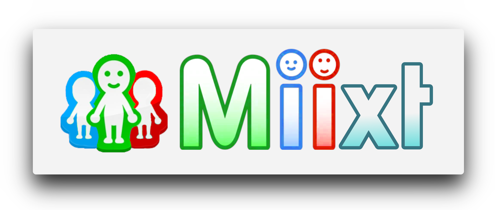

I created a community on Discord for Portuguese Nintendo fans, focused on players of modded Nintendo consoles like the Wii, Wii U, Nintendo 3DS, etc.

This is an attempt to centralize resources and players of all revival services (WiiLink24 and WFC and Pretendo Network) within the Portuguese audience, my country of origin. I felt inspired after the last big event I went to, Aniaki Winter Edition 2026 in Padre António Vieira High School in Lisbon, where I caught a lot more StreetPasses than before.

Given this, I've created the Discord Server, set up a number of resources within, and it's open for any to join.
I'll just say that it's mainly a Portuguese community, so if you're not Portuguese, I'd recommend joining the Pretendo and WiiLink servers independently.

Otherwise, bem-vindos!

Click the button below to join! See ya! :)

